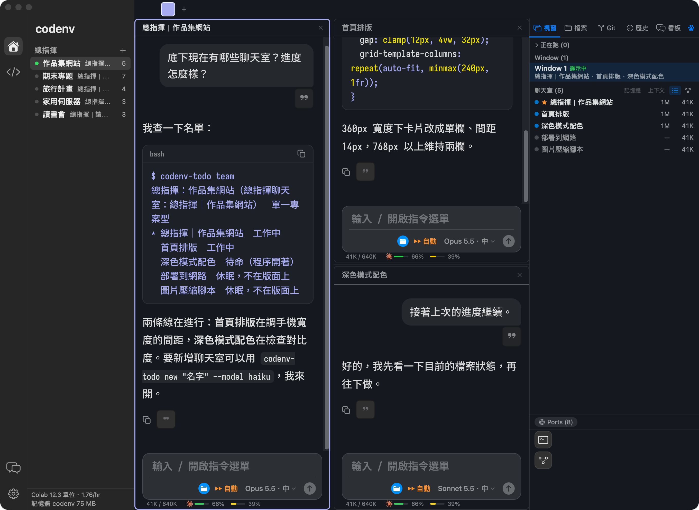
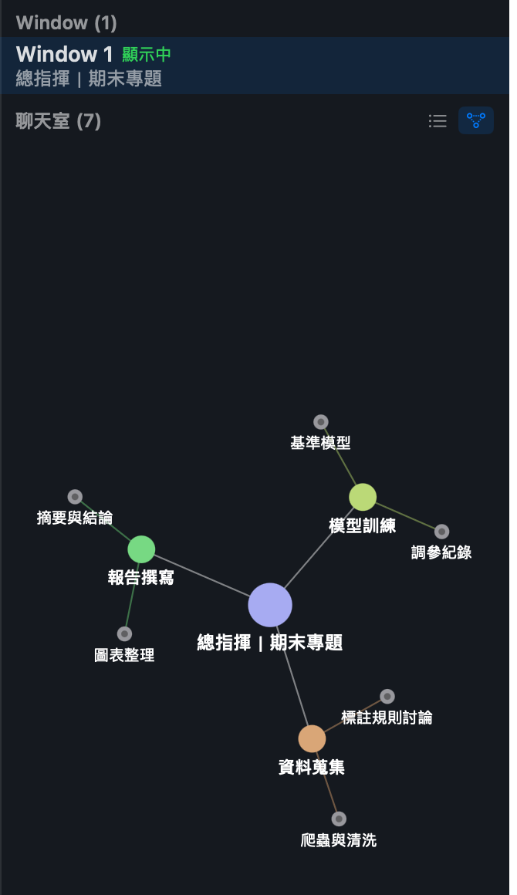

# codenv

English · [繁體中文](README.zh-TW.md)

Five Claude Code terminal tabs open at once, and an hour later you can’t tell which one is working, which one is waiting for your answer, or how much quota is left. codenv is a native macOS app that puts them in one window: every chat is a real Claude Code conversation, and you can split panes side by side like a terminal.

> codenv is a personal project and is not affiliated with Anthropic, OpenAI, GitHub, or Google.





## What it solves

- **One “commander” per project**: click to switch in the sidebar; the right panel (Windows / Files / Git / History / Board) shows every chat under that project, with full-text search across past conversations.
- **Commanders can delegate**: they open chats, rename them, switch models, and message other chats then read the reply (`codenv-todo new / rename / model / send / last …`, built in, no extra install). They can also open Codex or Copilot chats that don’t use your Claude quota (`--engine`).
- **Usage you can see**: remaining 5-hour and weekly quota for Claude and Codex under the input box and in the sidebar footer, plus a “usage sprint” card that nudges you to spend leftover quota before it resets.
- **Relationship graph and “areas”**: group chats into nested areas and see how they relate in the right panel or the large F6 graph.
- **Floating terminal (F5)**: run commands without leaving the chat; closing it keeps the process running.
- **Light on memory, careful with data**: per-chat MCP full / lite / none, idle chats shut down automatically; drafts, the outbox, and model-switch handoffs are protected, and on failure the old chat is left untouched.

## Turning on commanders

The sidebar starts as the classic tree. Go to Settings (⌘ ,) → Appearance (外觀) → Interface → Sidebar (左欄) and choose “Commanders (總指揮)”, then click ＋ next to “Commanders” (or the “New commander” button on the empty state). Fill in a name, pick the groups it covers (or create a new group tied to a folder), and choose a single-project or multi-project type.

## Open-source projects used and referenced

- [Claude Code](https://github.com/anthropics/claude-code): the heart of the app; each chat is a Claude Code conversation.
- [SwiftTerm](https://github.com/migueldeicaza/SwiftTerm): terminal pane (MIT, stored in `vendor/`; modifications are recorded in `vendor/PATCHES.md`).
- [marked](https://github.com/markedjs/marked), [highlight.js](https://github.com/highlightjs/highlight.js): Markdown and code highlighting in the chat interface.
- [Monaco Editor](https://github.com/microsoft/monaco-editor): editor for the coding practice area.
- [Codex CLI](https://github.com/openai/codex), [GitHub Copilot CLI](https://github.com/github/copilot-cli): optional alternative models.
- [mlx-lm](https://github.com/ml-explore/mlx-lm), [mlx-vlm](https://github.com/Blaizzy/mlx-vlm): run local models on Mac.
- [tmux](https://github.com/tmux/tmux): keyboard shortcuts and the “Session → Window → Pane” structure follow tmux conventions.
- [codenv_old](https://github.com/olilllioli287/codenv_old): predecessor to this app, a work environment assembled with vim and tmux.
- [claude-code-image-shelf](https://github.com/olilllioli287/claude-code-image-shelf): image annotation tool used for image editing in chats.

## Requirements

- macOS 14 or later, Apple Silicon
- [Claude Code](https://claude.com/claude-code) installed and signed in (you can run `claude` in Terminal)
- Optional: Codex CLI, GitHub Copilot CLI, local MLX models

## Installation

1. Download `codenv-<version>.dmg` from [Releases](https://github.com/olilllioli287/codenv-public/releases/latest), then drag codenv into “Applications.”
2. The app uses a temporary (ad-hoc) signature and is not signed by an Apple Developer. On macOS 15 and later, right-click → “Open” no longer bypasses Gatekeeper. Try to open it once (it will be blocked), then go to “System Settings → Privacy & Security,” scroll down to codenv and click “Open Anyway”; or run `xattr -cr /Applications/codenv.app` in Terminal.
3. Because it uses a temporary signature, **macOS treats it as a different app each time you install a new version**. Permissions you’ve granted (such as Full Disk Access) may need to be granted again after updating.

## Update reminder

codenv checks GitHub Releases for a new version 30 seconds after launch, then every 24 hours. You can also click “Check for updates (檢查更新)” in settings. It sends a regular request to `api.github.com` without any user data or identifier. You can turn this feature off with “Automatic update checks (自動檢查更新)” in settings. The app won’t replace itself: when a new version is available, it only displays the release notes; clicking the button opens the download page.

## Reporting a problem

“Report a problem… (回報問題…)” is available in settings and the menu. You can email codenvstudio@gmail.com or open a GitHub issue. Error logs are not attached by default; to attach them, select the option yourself. Usernames in file paths are replaced before anything is attached.

## agy (Google Antigravity CLI) — please read before using

Gemini chats, gray next-message suggestions, usage checks, and the Board feature that lets Claude hand work to agy all use codenv to call Google’s `agy`. Google’s official FAQ (<https://antigravity.google/docs/faq/>) says two different things:

1. Using agy’s sign-in to run third-party software (such as Claude Code or OpenCode) violates the Terms of Service and may get your account suspended. codenv does not do this: it never reads or reuses your sign-in; it only calls the official `agy -p`.

   > Using third-party software, tools, or services to access Antigravity is a violation of our Terms of Service … Such actions can result in suspension or termination of your account.

2. `agy -p` is meant for direct scripting and CI. Wrapping agy inside a third-party coding agent or app is “not supported” under consumer plans. The codenv features above fall into this category.

   > Antigravity CLI headless mode (`agy -p`) is intended for direct scripting and CI workflows. Wrapping `agy` inside third-party coding agents or applications, or automating account rotation, is not supported under consumer plans.

This feature is **on by default**. If codenv finds `agy` installed on your Mac, it shows a one-time reminder card (buttons “Got it” and “Go to Settings”) that says what codenv uses agy for, that Google’s consumer plans do not support this use, and where to turn it off. To turn it off at any time: Settings (⌘ ,) → Chat (對話) → agy. Please verify the actual situation yourself in related articles and Google’s latest statements; codenv does not guarantee your account will be safe, you accept the risk, and codenv does not attempt to hide itself.

## Building from source

```bash
git clone https://github.com/olilllioli287/codenv-public.git
cd codenv-public
./build.sh                                           # build, ad-hoc sign, install to ~/Applications/codenv.app
CODENV_SIGN_IDENTITY="My Certificate" ./build.sh   # sign with your own certificate (permissions survive rebuilds)
```

## Optional helper commands

`codenv-todo` (commander delegation and the shared collaboration board), `codenv-browser` (reads web content from browser panes), and `memory-check` are bundled inside the app, and chats started by codenv already have them on their `PATH`. To use them from your own terminal, open Settings → Data (資料) and click “Install to ~/.local/bin”.

## License

MIT (see `LICENSE`). Third-party code in `vendor/` and `Resources/` retains its original license.
