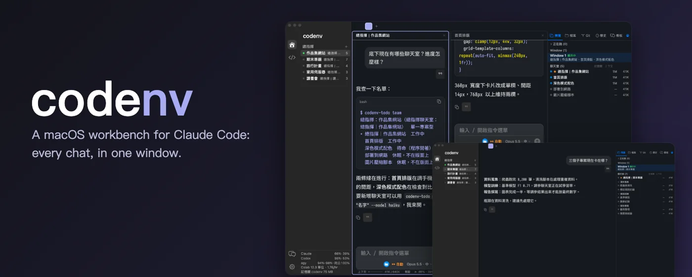
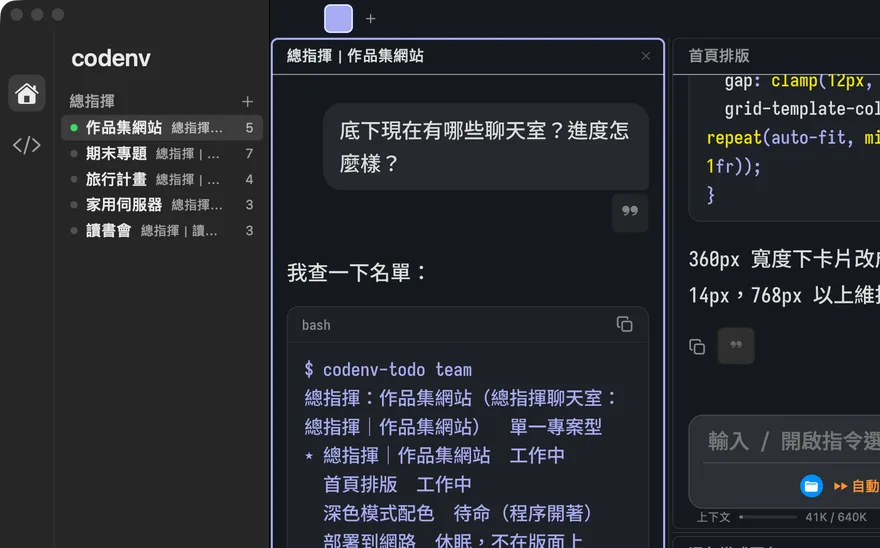
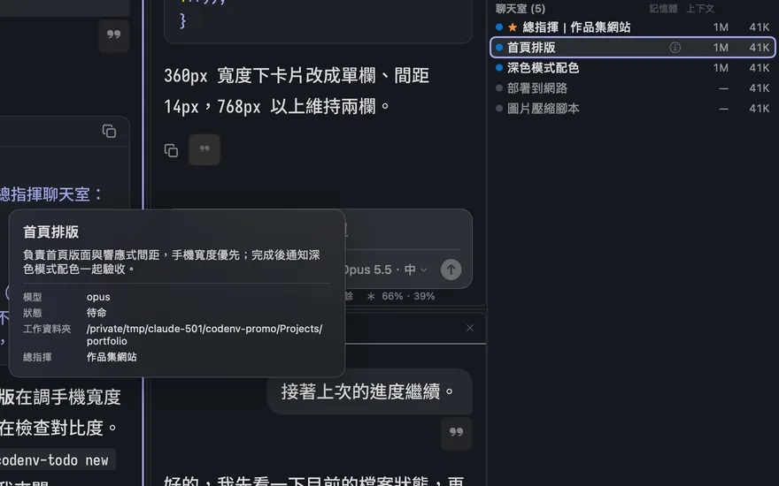
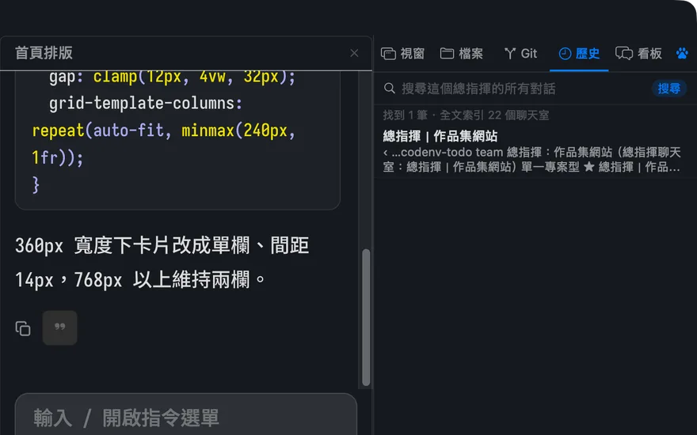
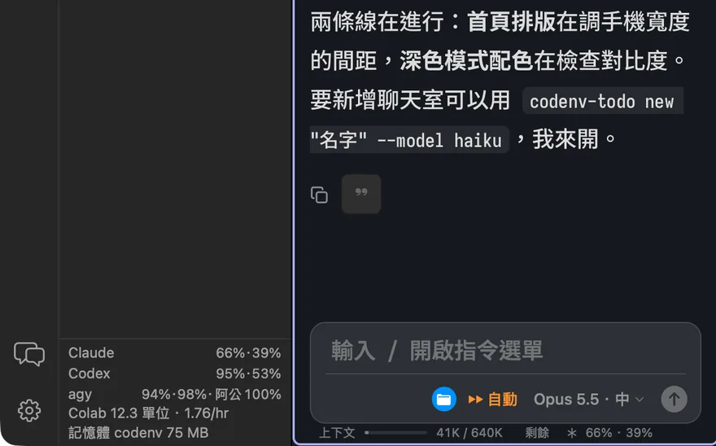
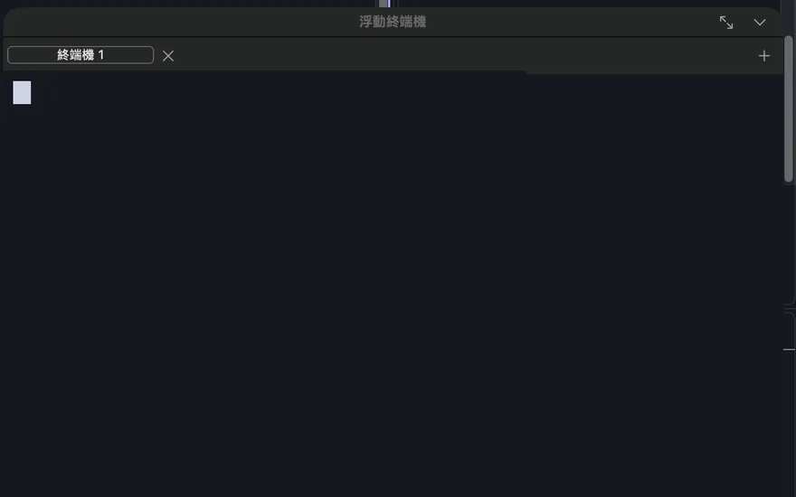
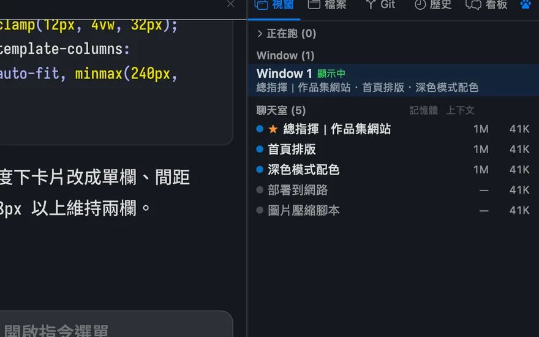

# codenv

English · [繁體中文](README.zh-TW.md)

<p align="center"></p>

A macOS app that puts Claude Code in a window that feels like a chat app and can be split up like a terminal. The sidebar manages projects and conversations; on the right, you can split chats, terminals, and web pages into multiple panes so several AIs can work at once.

Claude Code is the main focus, with optional support for Codex, GitHub Copilot, Apple’s built-in models, and local MLX models.

> codenv is a personal project and is not affiliated with Anthropic, OpenAI, GitHub, or Google.

## Highlights

<table>
<tr>
<td width="50%" valign="top">

<br><b>Commanders</b>
<br>One commander per project. Click one in the left sidebar; the right panel (Windows / Files / Git / History / Board) shows every chat underneath it. The commander’s own chat is pinned as the purple square at the far left of the tab bar (⌘ 1).
</td>
<td width="50%" valign="top">

<br><b>Chat descriptions</b>
<br>Write a short description for each chat (select it in the right panel and press <code>i</code>). It tells that chat’s Claude what it is responsible for, and it shows up in the commander’s roster and in <code>codenv-todo team</code>. Hover for 1.5 seconds to see an info card.
</td>
</tr>
<tr>
<td width="50%" valign="top">

<br><b>History search</b>
<br>Search every conversation under a commander from the right panel, backed by a local full-text index. Also available as <code>codenv-todo search</code>.
</td>
<td width="50%" valign="top">

<br><b>Usage at a glance</b>
<br>Remaining 5-hour and weekly quota for Claude and Codex appears under every input box and, one line per provider, at the bottom of the sidebar. Colab compute units show up too if the Colab CLI is installed.
</td>
</tr>
<tr>
<td width="50%" valign="top">

<br><b>Floating terminal (F5)</b>
<br>A terminal that floats over the chat and follows the current chat’s folder. Drag it, resize it, open several tabs; hide it and your programs keep running.
</td>
<td width="50%" valign="top">

<br><b>Lighter on memory</b>
<br>Per-chat memory and context sizes are listed in the right panel. Right-click a chat to load full, lite, or no MCP servers; chats left off-screen for 15 minutes have their Claude process shut down.
</td>
</tr>
</table>

### Turning on commanders

The sidebar starts as the classic tree. Go to Settings (⌘ ,) → Appearance (外觀) → Interface → Sidebar (左欄) and choose “Commanders (總指揮)”, then click ＋ next to “Commanders” (or the “New commander” button on the empty state). Fill in a name, pick the groups it covers (or create a new group tied to a folder), and choose a single-project or multi-project type. The `codenv-todo` commands (`new`, `rename`, `model`, `mcp`, `topic`, `team`) are built into the app, so commanders can open, rename, and re-model chats under them without any extra install.

## What’s here now

**Commanders and the right panel**
- Commander sidebar, a pinned commander tab (⌘ 1), a right panel with Windows / Files / Git / History / Board tabs, and full-text search across a commander’s conversations.
- Commanders delegate work with `codenv-todo` (`new`, `rename`, `model`, `mcp`, `topic`, `team`); each chat can carry a short description of what it is responsible for.
- Usage rows under each input box and in the sidebar footer, a floating terminal (F5), and lighter memory use (per-chat MCP lite/none, idle chats shut down after 15 minutes).

**Chat and conversations**
- Each chat is a real Claude Code conversation (the `claude -p` stream-json mode), displayed in a chat interface with Markdown, syntax-highlighted code, tool steps, and permission and multiple-choice cards.
- The input box supports pasted images and dragged files. Images and files appear as cards above the input box (files show their extensions; folders show a folder icon). Paths in the text can be deleted or skipped as a whole.
- File paths in conversations are clickable; clicking one reveals it in Finder. Chinese filenames and paths without backticks are recognized. Local images are displayed inline; images that can’t be loaded are shown as text instead of broken images.
- When you switch models, the previous conversation is automatically handed off to the new model. Long conversations are automatically compacted, with a configurable threshold.
- When the input box is empty, a gray suggestion predicts what you might say next. Press Tab to accept it.

**Layout and windows**
- The sidebar lets you group conversations, create subgroups, drag to reorder, and archive conversations that haven’t been used for a week.
- Split panes horizontally or vertically within a Window, drag to adjust their proportions, and restore the same layout after ⌘ Q.
- Keyboard controls follow tmux conventions (Ctrl + A prefix), with Mac shortcuts too: ⌘ W closes the current pane; ⌘ ⇧ T restores the last closed pane or entire Window exactly as it was.

**Browser panes and gadgets**
- Built-in browser pane (WebKit) supports signing in to websites and uploading files. Use ⌘ + / ⌘ − to zoom; zoom levels are remembered per website.
- “Bundle”: group chats in the sidebar inside a purple frame, then attach gadgets beneath them — Gemini, NotebookLM, or any web page. Press ⌘ ⇧ B to slide the gadget out from the right, then press it again to hide it. Hiding it only makes it invisible; the web page doesn’t reload.
- AIs can use the `codenv-browser` command to read text or take screenshots from browser panes, but they can only read, not interact.

**Multiple AIs working together**
- Collaboration board: create goals, break them into steps, and assign owners. Goals created by Claude require your approval before work begins; only you can check off the final “User acceptance” step.
- Two Claude chats can message each other and divide up work, such as one writing code while the other reviews and publishes it.
- Scheduling: automatically send a message to a conversation at a specified time.
- The right sidebar shows each provider’s remaining usage, which model each pane is using, and the length of each conversation.

**Coding practice area**
- Built-in Monaco Editor lets you write and run C/C++/Python practice programs without creating a separate folder.

**Other**
- Update reminder: the sidebar reminds you when a new version is available, with options to read the release notes, download it, or skip this version.
- Reporting a problem: send an email or open a GitHub issue, with version information filled in for you.
- When offline, tools that require sign-in won’t be invoked, preventing repeated sign-in prompts.

## Open-source projects used and referenced

- [Claude Code](https://github.com/anthropics/claude-code): the heart of the app; each chat is a Claude Code conversation.
- [SwiftTerm](https://github.com/migueldeicaza/SwiftTerm): terminal pane (MIT, stored in `vendor/`; modifications are recorded in `vendor/PATCHES.md`).
- [marked](https://github.com/markedjs/marked), [highlight.js](https://github.com/highlightjs/highlight.js): Markdown and code highlighting in the chat interface.
- [Monaco Editor](https://github.com/microsoft/monaco-editor): editor for the coding practice area.
- [Codex CLI](https://github.com/openai/codex), [GitHub Copilot CLI](https://github.com/github/copilot-cli): optional alternative models.
- [mlx-lm](https://github.com/ml-explore/mlx-lm), [mlx-vlm](https://github.com/Blaizzy/mlx-vlm): run local models on Mac.
- [tmux](https://github.com/tmux/tmux): keyboard shortcuts and the “Session → Window → Pane” structure follow tmux conventions.
- [codenv_old](https://github.com/olilllioli287/codenv_old): predecessor to this app, a work environment assembled with vim and tmux.
- [claude-code-image-shelf](https://github.com/olilllioli287/claude-code-image-shelf): image annotation tool used for image editing in chats.

## What’s next

- **Claude Code is the main focus**: first, make the Claude experience solid; other models remain optional as before.
- **Coding practice area**: expand it with features such as chapter-based exercises, learning from a textbook with an AI tutor, and better run and debug screens.
- **New features**: keep adding useful everyday features. Suggestions are welcome in issues.
- **What’s next for bundles**: gadgets can currently host Gemini, NotebookLM, and web pages. The plan is to make gadgets interact more with the chats they’re attached to, and to evaluate a Chromium-based browser pane.

## Requirements

- macOS 14 or later, Apple Silicon
- [Claude Code](https://claude.com/claude-code) installed and signed in (you can run `claude` in Terminal)
- Optional: Codex CLI, GitHub Copilot CLI, local MLX models

## Installation

1. Download `codenv-<version>.dmg` from [Releases](https://github.com/olilllioli287/codenv-public/releases/latest), then drag codenv into “Applications.”
2. The app uses a temporary (ad-hoc) signature and is not signed by an Apple Developer. The first time you open it, right-click codenv → “Open” → “Open.” If it still won’t open, go to “System Settings → Privacy & Security” and click “Open Anyway.”
3. Because it uses a temporary signature, **macOS treats it as a different app each time you install a new version**. Permissions you’ve granted (such as Full Disk Access) may need to be granted again after updating.

## Update reminder

codenv checks GitHub Releases for a new version 30 seconds after launch, then every 24 hours. You can also click “Check for updates (檢查更新)” in settings. It sends a regular request to `api.github.com` without any user data or identifier. You can turn this feature off with “Automatic update checks (自動檢查更新)” in settings. The app won’t replace itself: when a new version is available, it only displays the release notes; clicking the button opens the download page.

## Reporting a problem

“Report a problem… (回報問題…)” is available in settings and the menu. You can email codenvstudio@gmail.com or open a GitHub issue. Error logs are not attached by default; to attach them, select the option yourself. Usernames in file paths are replaced before anything is attached.

## agy (Google Antigravity CLI) — please read before using

Gemini chats, gray next-message suggestions, usage checks, and the Board feature that lets Claude hand work to agy all use codenv to call Google’s `agy`. Google’s official FAQ (<https://antigravity.google/docs/faq/>) says two different things:

1. Using agy’s sign-in to run third-party software (such as Claude Code or OpenCode) violates the Terms of Service and may get your account suspended. codenv does not do this: it never reads or reuses your sign-in; it only calls the official `agy -p`.

   > Using third-party software, tools, or services to access Antigravity is a violation of our Terms of Service … Such actions can result in suspension or termination of your account.

2. `agy -p` is meant for direct scripting and CI. Wrapping agy inside a third-party coding agent or app is “not supported” under consumer plans. The codenv features above fall into this category.

   > Antigravity CLI headless mode (`agy -p`) is intended for direct scripting and CI workflows. Wrapping `agy` inside third-party coding agents or applications, or automating account rotation, is not supported under consumer plans.

This feature is **on by default**, and codenv shows a reminder once before first use. To turn it off: Settings → 對話 (Chat) → agy. Please verify the actual situation yourself in related articles and Google’s latest statements; codenv does not guarantee your account will be safe, you accept the risk, and codenv does not attempt to hide itself.

## Building from source

```bash
git clone https://github.com/olilllioli287/codenv-public.git
cd codenv-public
./build.sh                                           # build, ad-hoc sign, install to ~/Applications/codenv.app
CODENV_SIGN_IDENTITY="My Certificate" ./build.sh   # sign with your own certificate (permissions survive rebuilds)
```

## Optional helper commands

`codenv-todo` (commander delegation and the shared collaboration board), `codenv-browser` (reads web content from browser panes), and `memory-check` are bundled inside the app, and chats started by codenv already have them on their `PATH`. To use them from your own terminal, open Settings → Data (資料) and click “Install to ~/.local/bin”.

## License

MIT (see `LICENSE`). Third-party code in `vendor/` and `Resources/` retains its original license.
