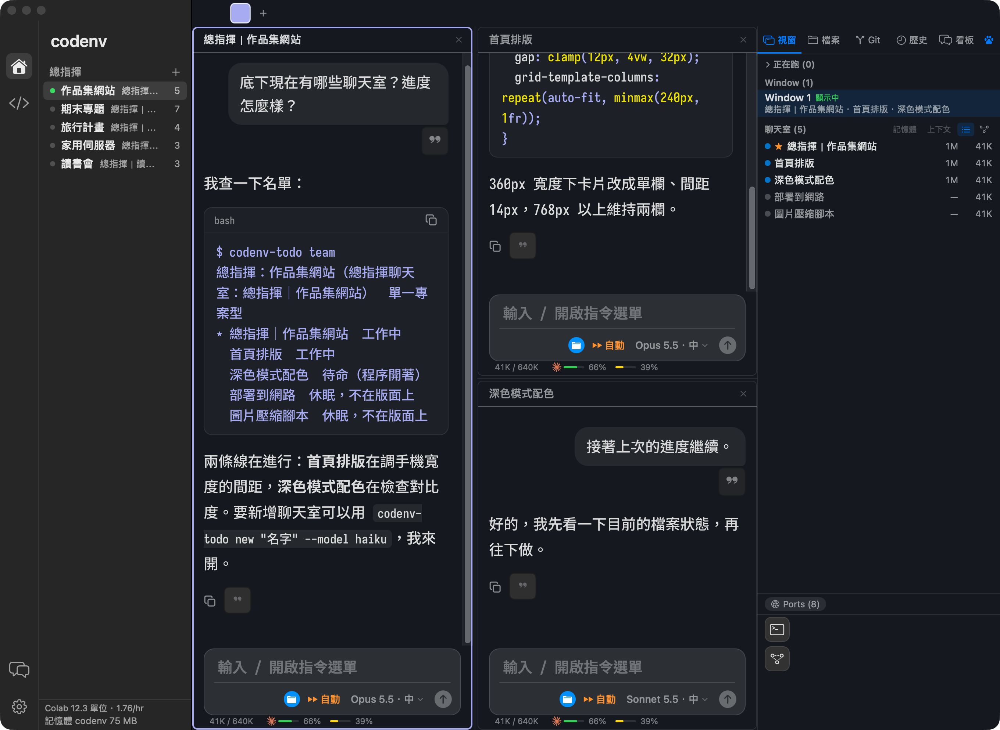
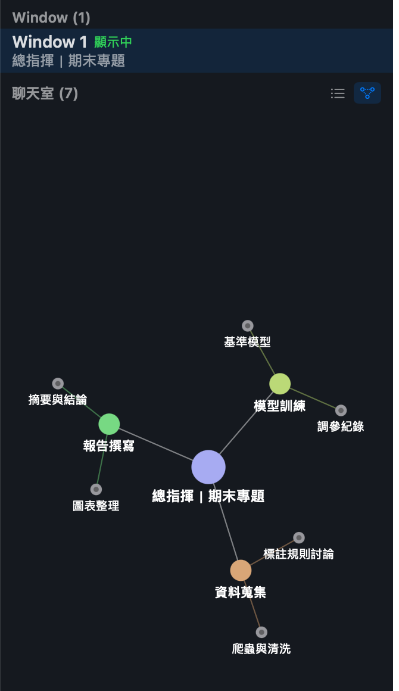

# codenv

[English](README.md) · 繁體中文

同時開著五個 Claude Code 終端機分頁，過一小時就不知道哪個在做什麼、哪個卡在等你回答、額度還剩多少。codenv 是一個 macOS 原生 App，把這些放進同一個視窗：每個聊天室都是真的 Claude Code 對話，還能像終端機一樣分格並排。

> codenv 是個人專案，跟 Anthropic、OpenAI、GitHub、Google 都沒有關係。





## 它解決什麼

- **一個專案一位「總指揮」**：左欄點一下切換，右欄（視窗／檔案／Git／歷史／看板）看這個專案底下所有聊天室，還能全文搜尋歷史對話。
- **總指揮可以派工**：由它幫你開聊天室、改名、換模型、傳訊息給別的聊天室再讀回答（`codenv-todo new／rename／model／send／last…`，已內建，不用另外裝）。也能開不花 Claude 額度的 Codex、Copilot 聊天室（`--engine`）。
- **額度看得到**：輸入框下方和左下角直接顯示 Claude、Codex 的 5 小時與本週剩餘；還有「額度衝刺」卡片，快重置時提醒你把額度用完。
- **關聯圖與「區」**：把聊天室分成巢狀的區，右欄和 F6 大面板用關聯圖看誰跟誰有關。
- **浮動終端機（F5）**：不離開聊天就能跑指令，收起來程式繼續跑。
- **省記憶體、不丟資料**：聊天室可選 MCP 完整／精簡／不載入，待命太久自動收掉；草稿、寄件匣、換模型交接都有保護，失敗時舊的不動。

## 怎麼開總指揮

預設是原本的樹狀左欄。到 設定（⌘ ,）→ 外觀 → 介面 → 左欄，選「總指揮」，再按左欄「總指揮」旁的 ＋（或空狀態的「新增總指揮」），填名稱、選要管的分組（或新建一個分組並指到資料夾）、選單一或多個子專案就行。

## 用到、參考的開源專案

- [Claude Code](https://github.com/anthropics/claude-code)：主角，每個聊天室都是一段 Claude Code 對話。
- [SwiftTerm](https://github.com/migueldeicaza/SwiftTerm)：終端機格子（MIT，放在 `vendor/`，修改處記在 `vendor/PATCHES.md`）。
- [marked](https://github.com/markedjs/marked)、[highlight.js](https://github.com/highlightjs/highlight.js)：聊天畫面的 Markdown 和程式碼上色。
- [Monaco Editor](https://github.com/microsoft/monaco-editor)：程式碼學習區的編輯器。
- [Codex CLI](https://github.com/openai/codex)、[GitHub Copilot CLI](https://github.com/github/copilot-cli)：可選的其他模型。
- [mlx-lm](https://github.com/ml-explore/mlx-lm)、[mlx-vlm](https://github.com/Blaizzy/mlx-vlm)：在 Mac 上跑本機模型。
- [tmux](https://github.com/tmux/tmux)：快捷鍵和「Session → Window → 格子」的結構，都是照 tmux 的習慣做的。
- [codenv_old](https://github.com/olilllioli287/codenv_old)：這個 App 的前身，用 vim 加 tmux 拼成的工作環境。
- [claude-code-image-shelf](https://github.com/olilllioli287/claude-code-image-shelf)：圖片標註工具，聊天室裡的圖片編輯用的就是它。

## 需求

- macOS 14 以上、Apple Silicon
- 已安裝並登入 [Claude Code](https://claude.com/claude-code)（在終端機打 `claude` 能用）
- 可選：Codex CLI、GitHub Copilot CLI、本機 MLX 模型

## 安裝

1. 到 [Releases](https://github.com/olilllioli287/codenv-public/releases/latest) 下載 `codenv-<版本>.dmg`，把 codenv 拖進「應用程式」。
2. App 用的是臨時（ad-hoc）簽章，沒有 Apple 開發者簽名。macOS 15 以後按右鍵「打開」已經繞不過 Gatekeeper：先試著打開一次（會被擋），再到「系統設定 → 隱私權與安全性」往下找到 codenv，按「強制打開」；或在終端機執行 `xattr -cr /Applications/codenv.app`。
3. 因為是臨時簽章，**每次換新版，macOS 都會把它當成不同的 App**：你給過的權限（例如完整磁碟取用權限）更新後可能要重新給一次。

## 更新提醒

codenv 開啟 30 秒後會檢查一次 GitHub Releases 有沒有新版，之後每 24 小時檢查一次，也可以在設定裡按「檢查更新」。它只對 `api.github.com` 送出一個普通的請求，不帶任何使用者資料，也不帶識別碼。這個功能可以在設定的「自動檢查更新」關掉。它不會自己替換 App：有新版時只顯示更新說明，按下按鈕才開啟下載頁。

## 回報問題

設定頁和選單裡都有「回報問題…」，可以寄 email 到 codenvstudio@gmail.com，或到 GitHub 開 issue。錯誤紀錄預設不附；要附的話自己勾選，附之前會先把路徑裡的使用者名稱換掉。

## agy（Google Antigravity CLI）：使用前請看

Gemini 聊天室、灰字下一句建議、用量查詢、看板讓 Claude 自動派工作給 agy，都是由 codenv 去呼叫 Google 的 `agy`。Google 官方 FAQ（<https://antigravity.google/docs/faq/>）講了兩件不同的事：

1. 拿 agy 的登入去開第三方軟體（例如 Claude Code、OpenCode）是違反服務條款，可能被停權。codenv 沒有這樣做：它不讀、不轉用你的登入，只是呼叫官方的 `agy -p`。

   > Using third-party software, tools, or services to access Antigravity is a violation of our Terms of Service … Such actions can result in suspension or termination of your account.

2. `agy -p` 是給「直接寫腳本和 CI」用的；把 agy 包進第三方的 coding agent 或 App，個人方案「不支援」。codenv 的上述功能都屬於這一類。

   > Antigravity CLI headless mode (`agy -p`) is intended for direct scripting and CI workflows. Wrapping `agy` inside third-party coding agents or applications, or automating account rotation, is not supported under consumer plans.

這個功能**預設開啟**。codenv 偵測到你的 Mac 裝了 `agy` 時，會跳出一次性的提醒卡片（按鈕是「知道了」和「前往設定」），寫明 codenv 用 agy 做哪些事、Google 的個人方案不支援這種用法，以及在哪裡關掉；想關隨時可以到 設定（⌘ ,）→ 對話 → agy 關掉。實際狀況請自己查證相關文章與 Google 的最新說明；codenv 不保證你的帳號不會出事，風險由你自己承擔，也沒有做任何隱藏自己的處理。

## 從原始碼編譯

```bash
git clone https://github.com/olilllioli287/codenv-public.git
cd codenv-public
./build.sh                                   # 編譯、臨時簽章、裝到 ~/Applications/codenv.app
CODENV_SIGN_IDENTITY="我的憑證" ./build.sh   # 用自己的憑證簽章（重新編譯後權限不會掉）
```

## 可選的輔助指令

`codenv-todo`（總指揮派工與多個 AI 共用的協作看板）、`codenv-browser`（讀瀏覽器格子的網頁內容）和 `memory-check` 都已內建在 App 裡，codenv 開的聊天室 `PATH` 已經帶好。要在自己的終端機用，到 設定 → 資料，按「安裝到 ~/.local/bin」。

## 授權

MIT（見 `LICENSE`）。`vendor/` 和 `Resources/` 裡的第三方程式各自保留原本的授權。
